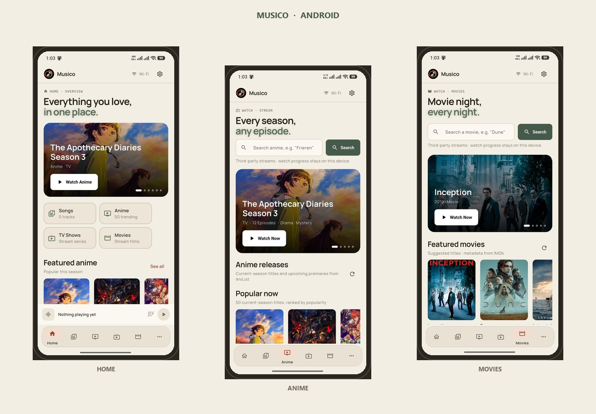
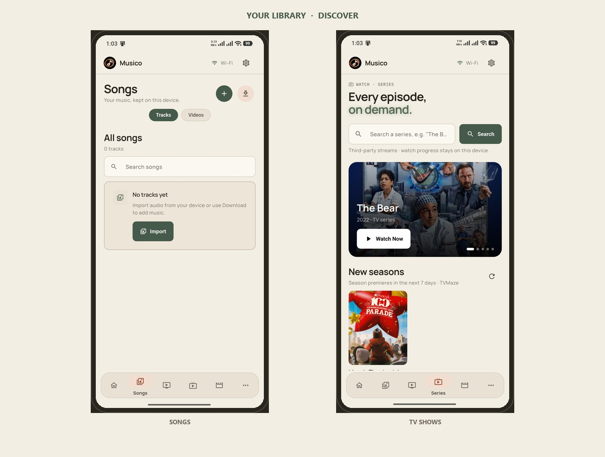

<div align="center">
  
  <h1>Musico</h1>
  <p><strong>A personal media shelf for Windows and Android.</strong></p>
  <p>Listen offline. Find your next watch. Keep your library yours.</p>
  <p>
    <a href="https://github.com/Noone-prachan/Musico/releases/latest">
      
    </a>
    <a href="https://github.com/Noone-prachan/Musico/releases/latest">
      
    </a>
  </p>
  <p>
    
    
    
  </p>
</div>

---

Musico brings an offline music player, local video library, media discovery,
and release tracking into one app. Your own files and playback progress stay
on your device; online features connect to the services they need.

**[Get the latest release](https://github.com/Noone-prachan/Musico/releases/latest)**
· **[Watch the YouTube media walkthrough](docs/youtube-media-ripper-explainer.mp4)**
· **[Report a bug or request a feature](https://github.com/Noone-prachan/Musico/issues)**

## Explore Musico

<table>
  <tr>
    <td width="50%" valign="top">
      <h3>01 · Listen</h3>
      <p>Build a music library from files on your device and play it offline.</p>
      <ul>
        <li>Playlists, queue, shuffle, repeat, autoplay, and sorting</li>
        <li>Per-track playback trims that never rewrite the source audio</li>
        <li>Lyrics lookup and synchronized lyrics when available</li>
        <li>Android playback notification and Windows media controls</li>
      </ul>
    </td>
    <td width="50%" valign="top">
      <h3>02 · Find</h3>
      <p>Discover music and artwork from sources with clear reuse terms.</p>
      <ul>
        <li>Browse eligible audio from Wikimedia Commons</li>
        <li>Automatically look up matching, openly licensed cover art</li>
        <li>Keep attribution with the saved music and artwork</li>
        <li>Import Spotify playlist exports as metadata, not audio</li>
      </ul>
    </td>
  </tr>
  <tr>
    <td width="50%" valign="top">
      <h3>03 · Watch</h3>
      <p>Keep local videos and online discovery in one place.</p>
      <ul>
        <li>Import and organize videos stored on your device</li>
        <li>Browse anime, TV, and movie catalogs</li>
        <li>Save a watchlist and resume supported streams</li>
        <li>Use subtitles and Android picture-in-picture where available</li>
      </ul>
    </td>
    <td width="50%" valign="top">
      <h3>04 · Keep up</h3>
      <p>Follow releases and save your progress between sessions.</p>
      <ul>
        <li>Browse anime seasons, schedules, and upcoming releases</li>
        <li>Get release reminders on Android</li>
        <li>Refresh schedules on Windows while Musico is open</li>
        <li>Back up settings, lists, metadata, artwork, and media to ZIP</li>
      </ul>
    </td>
  </tr>
</table>

## Screenshots

Musico running on Android:

<p align="center">
  
</p>
<p align="center"><sub>Home &middot; Anime &middot; Movies</sub></p>

<p align="center">
  
</p>
<p align="center"><sub>Songs &middot; TV Shows</sub></p>

For help choosing a streaming source, see the
[streaming provider guide](docs/streaming-provider-guide/README.md), also
available as a download from the
[v1.0.2 release](https://github.com/Noone-prachan/Musico/releases/download/v1.0.2/Musico-Streaming-Provider-Guide-v1.0.2.zip).

## YouTube downloads

Search YouTube inside Musico and save eligible results as MP3 audio or MP4
video. Choose an available video quality, set a filename, and add completed
downloads to your local library. Musico avoids overwriting existing files and
saves source details alongside each download.

Downloads require an internet connection and can be affected by changes to
YouTube. Only save content you have permission to use. Read the
[YouTube media guide](docs/youtube-media-ripper.md) for storage details and
troubleshooting.

## Download and install

Choose the installer or APK from the
[latest GitHub release](https://github.com/Noone-prachan/Musico/releases/latest).

| Platform | Package | Install notes |
| --- | --- | --- |
| Windows | [`Musico-Setup.exe`](https://github.com/Noone-prachan/Musico/releases/latest/download/Musico-Setup.exe) | Recommended. Choose the app and media locations during setup. |
| Windows portable | [`Musico-Windows-x64.zip`](https://github.com/Noone-prachan/Musico/releases/latest/download/Musico-Windows-x64.zip) | Extract the ZIP and run `Musico.exe`; keep the bundle together. |
| Android | [Musico APK on Releases](https://github.com/Noone-prachan/Musico/releases/latest) | Download the APK, open it, and approve installation if Android asks. |

The Windows installer defaults to
`%LOCALAPPDATA%\Programs\Musico` for the app and
`%USERPROFILE%\Downloads\Musico` for media. Both locations can be changed.
The Android APK is locally signed for direct installation and is not currently
distributed through Google Play.

## Your files and online services

- Imported and downloaded files are kept in Musico's local library. Musico
  does not upload them to a Musico-hosted media server.
- Lyrics and artwork searches use track metadata; the audio itself is not sent.
- Search, catalogs, schedules, and streaming contact their respective online
  providers. Those services can change or become unavailable.
- Streamed TV, movie, and anime media is not downloaded by the streaming
  feature.
- Wikimedia music and Openverse artwork are limited to supported public-domain,
  CC0, CC BY, or CC BY-SA results when license data is available. Attribution
  is preserved.
- You are responsible for applicable laws, service terms, copyright, and
  license conditions when accessing or saving media.

## Build from source

### Requirements

- Flutter **3.50+** and Dart **3.14+**
- Android builds: Android SDK and accepted SDK licenses
- Windows builds: Visual Studio Build Tools with **Desktop development with
  C++** and C++ ATL
- Windows Flutter development: Developer Mode for plugin symlinks

### Run locally

```powershell
flutter pub get
flutter run -d windows
```

For Android, connect a device with USB debugging enabled, then select its ID
from `flutter devices`:

```powershell
flutter devices
flutter run -d <device-id>
```

### Build release packages

```powershell
flutter build windows --release
flutter build apk --release --target-platform android-arm64,android-x64
```

Build the Windows installer and portable ZIP, including the bundled YouTube
runtime dependencies, with:

```powershell
.\installer\build_musico_release.ps1
```

Build output is written to `build\windows\x64\runner\Release` and
`build\app\outputs\flutter-apk`. The release script places packaged artifacts
in `%USERPROFILE%\Downloads\Musico-Release` by default.

### Main integrations

| Purpose | Services and libraries |
| --- | --- |
| Audio playback | `just_audio`, `audio_service` |
| Local and streamed video | `media_kit` |
| YouTube search and downloads | `yt-dlp`, Deno, FFmpeg |
| Lyrics and cover art | LRCLIB, Openverse |
| Licensed music | Wikimedia Commons |
| Anime and release data | AniList |
| TV and movie metadata | IMDb, TVMaze |

Before submitting a code change, run:

```powershell
flutter analyze
flutter test
```

## Contributing

Bug reports and feature requests are welcome in
[GitHub Issues](https://github.com/Noone-prachan/Musico). For a code change,
include the affected platform and the behavior you tested.

## License

Musico's original code is source-available under the
[Musico End User License Agreement](LICENSE): personal, non-commercial use is
permitted, but redistribution and reuse in other projects require written
permission. This is not an OSI-approved open-source license. Third-party
libraries, fonts, and other materials retain their own licenses and notices.
