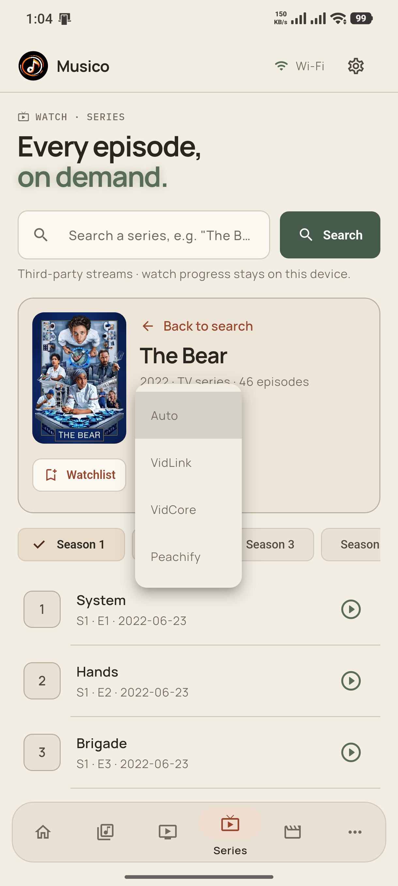
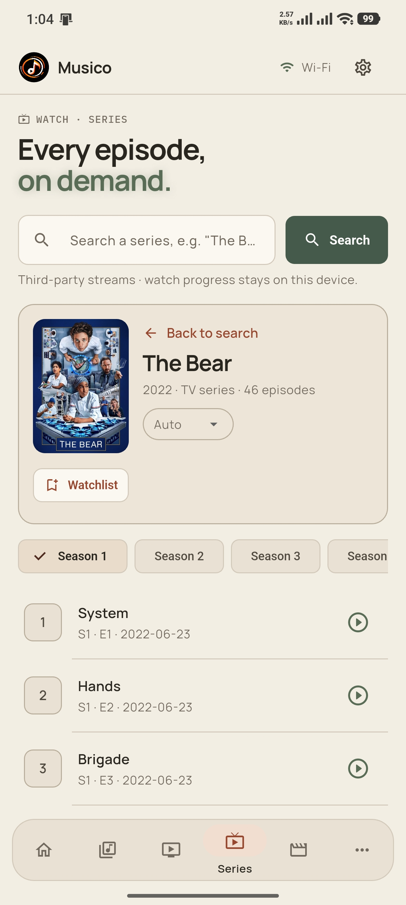

# Changing a streaming provider

Use the provider menu on a movie or TV show page to choose which embedded
source Musico uses for playback.

1. Open **TV Shows** or **Movies**, then search for and open a title.
2. On the title page, tap the provider menu. It displays **Auto** when
   automatic selection is active.
3. Choose **VidLink**, **VidCore**, or **Peachify** to select a source
   manually. Choose **Auto** to return to automatic selection.
4. Start the movie or select an episode to play. If a source is unavailable,
   reopen the menu and try another option.

The selection changes the playback source; it does not download the video.
Streaming sources are third-party services and may change or become
unavailable.

## Screenshots

<table>
  <tr>
    <td align="center">
      
       Available providers
    </td>
    <td align="center">
      
       Auto selected
    </td>
  </tr>
</table>
